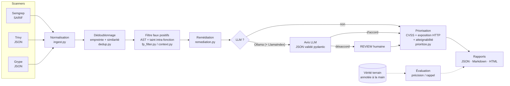

# llm-vuln-triage — triage de vulnérabilités SAST/SCA assisté par LLM local

> **EN summary** — A local, auditable triage layer on top of Semgrep (SAST) and Trivy/Grype (SCA).
> It normalises SARIF/JSON reports, merges duplicates across rules and tools, discards false
> positives with a code-based justification (Python AST: constant arguments, bound SQL
> parameters, safe YAML loaders, test paths, `usedforsecurity=False`), ranks what is left with
> CVSS + context (HTTP-exposed route, taint from `request`, dependency reachability) and proposes
> a fix. An optional local LLM (Ollama, with LlamaIndex code retrieval) can *advise*: its output
> must pass a strict JSON schema, and any disagreement sends the finding to human review — the
> LLM can never silently drop an alert. On **real Semgrep + Trivy + Grype scans** of the bundled vulnerable app:
> **86 raw alerts → 45 to handle (−48 %)**, mostly by merging the same CVE reported by Trivy and Grype under
> different IDs. Running it on real scans also surfaced (and fixed) a bug that had dismissed a real SQL injection.

---

## Pourquoi

Un scan SAST + SCA sur un vrai projet produit vite des centaines d'alertes : doublons entre
règles et entre outils, faux positifs évidents pour un humain qui lit le code, et aucune
hiérarchie liée au contexte (une CVE dans une dépendance jamais importée ≠ une injection SQL
sur une route publique). Ce projet automatise la première passe de tri d'un analyste AppSec,
en gardant chaque décision **justifiée, traçable et réversible**.

## Architecture



| Étape | Ce qui est fait concrètement |
|---|---|
| Normalisation | SARIF 2.1.0 (Semgrep, ou tout outil SARIF), `trivy fs -f json`, `grype -o json` → un modèle `Finding` unique (CWE, fichier/ligne, paquet/version, CVSS, version corrigée). |
| Dédoublonnage | Clé exacte `fichier:ligne:CWE` (SAST) / `paquet:CVE` (SCA), puis rapprochement flou : même fichier et CWE, lignes à ±2, snippet identique ou message similaire (`difflib`). Outils et règles fusionnés sont conservés. |
| Faux positifs | Règles fondées sur un **fait vérifiable dans l'AST**, jamais sur le message : argument constant (littéral, f-string sans interpolation, concaténation de constantes, variable toujours constante), requête SQL constante + paramètres liés, `yaml.safe_load` / `Loader=SafeLoader`, `hashlib.*(usedforsecurity=False)`, fichiers de test, placeholders de secrets. Taint intra-fonction par point fixe depuis `request`. |
| Priorisation | SCA : CVSS v3 + atteignabilité (`direct` si importé, `transitive` si dépendance d'un paquet importé, `unused` sinon). SAST : gravité estimée par classe CWE + bonus si route HTTP **et** donnée issue de la requête, malus sans chemin externe. Seaux P1 (≥ 9) … P4. |
| Remédiation | Correctif type par CWE avec extrait de code ; version minimale corrigée pour le SCA. |
| LLM (optionnel) | Prompt avec contexte de code (fenêtre locale, ou extraits récupérés par un index LlamaIndex du dépôt), réponse JSON imposée (`format: json`, température 0), validée par un schéma (`verdict`, `justification`, `confidence`, `priority_adjustment ∈ [-2,2]`, `fix`). Sortie invalide → ignorée ; désaccord → `REVIEW`. |

## Démarrage

```bash
pip install -r requirements.txt     # PyYAML, Jinja2, pydantic (optionnel), pytest
make demo                           # triage des rapports d'exemple + évaluation
make test                           # 16 tests pytest
```

Sortie de `make demo` (réelle) :

```
Alertes brutes          : 25  {'semgrep': 15, 'trivy': 5, 'grype': 5}
Après dédoublonnage     : 20  (−5)
Faux positifs écartés   : 5
À traiter               : 15  {'P1': 5, 'P2': 5, 'P3': 4, 'P4': 1}  (−40.0 % de bruit)
Filtre FP               : précision 1.0 · rappel 1.0 (20/20 annotées)
Rapports                : out/triage.json, out/triage.md, out/triage.html
```

Exemples de rapports générés : [`examples/sample_report.md`](examples/sample_report.md) et
`examples/sample_report.html`.

### Avec les vrais scanners

```bash
pip install semgrep            # + binaires trivy et/ou grype
make scan                      # scripts/run_scanners.sh → reports/*.json → out-real/
```

### Avec un LLM local (Ollama)

```bash
ollama serve & ollama pull qwen2.5-coder:7b
make demo-llm MODEL=qwen2.5-coder:7b
# contexte par index vectoriel du dépôt :
pip install -r requirements-llm.txt && ollama pull nomic-embed-text
```

Aucune donnée ne quitte la machine : le modèle et les embeddings tournent en local.

### En CI

`.github/workflows/triage.yml` et `.gitlab-ci.yml` : tests + démo, puis job de scan réel
(Semgrep + Trivy) suivi du triage. `--fail-on P1` fait échouer le pipeline s'il reste une
alerte P1 (en `allow_failure` ici puisque la cible est volontairement vulnérable).

## Contenu du dépôt

```
target_app/            application Flask VOLONTAIREMENT vulnérable (+ pièges à faux positifs)
  requirements.txt     dépendances obsolètes connues vulnérables (cible SCA)
fixtures/              rapports d'EXEMPLE au format exact des outils + vérité terrain annotée
scripts/               génération des fixtures, lancement des vrais scanners
triage/                le pipeline (ingest, dedup, context, fp_filter, prioritize, remediation, llm, report, cli)
tests/                 tests pytest (dont motifs absents de la cible, couche LLM simulée)
examples/              rapports générés par `make demo`
```

## Résultats

Tout a été exécuté sous Windows 11 (Semgrep, Trivy, Grype, Ollama `llama3.1:8b`, LlamaIndex).

### 1. Vrais scans de `target_app/`

`semgrep --config p/python --config p/flask --config p/secrets`, `trivy fs`, `grype dir:` :

| | Déterministe | Avec LLM (conseil) |
|---|---|---|
| Alertes brutes (8 Semgrep + 39 Trivy + 39 Grype) | 86 | 86 |
| Après dédoublonnage | **45** (−41) | 45 |
| Faux positifs écartés | 0 | 0 |
| P1 / P2 / P3 / P4 | 6 / 6 / 24 / 9 | 7 / 5 / 25 / 8 |
| Avis LLM valides / en désaccord avec les règles | – | 45 / 29 |

- **Le gain vient du dédoublonnage inter-outils.** Trivy et Grype remontent les mêmes 39 vulnérabilités, mais Grype les
  identifie souvent par l'avis GitHub (`GHSA-…`) et range le CVE dans `relatedVulnerabilities` : sans normalisation,
  seuls 2 doublons étaient fusionnés (86 → 84).
- **Aucun faux positif écarté sur les vrais scans** : les règles du registre Semgrep ne se sont pas déclenchées sur les
  pièges prévus (requête paramétrée, `yaml.safe_load`, code de test…). Elles ont en revanche **manqué** plusieurs failles
  plantées (path traversal, `yaml.load`, `pickle`, secret en dur) : 8 alertes SAST seulement.
- **Bug trouvé grâce au vrai scan, corrigé** : Semgrep signale l'injection SQL sur une région de 3 lignes qui commence
  par `request.args.get("id", "")`. Le filtre ne regardait que la 1re ligne, y voyait un appel à 2 arguments constants et
  concluait à une requête paramétrée : **une vraie SQLi était écartée**. Le filtre cherche maintenant le vrai point
  sensible (`execute`) dans toute la région, et un test de régression couvre le cas.
- Avec le LLM, 29 avis sur 45 contredisent les règles : ces alertes partent en revue humaine au lieu d'être modifiées.

### 2. Rapports d'exemple annotés (`fixtures/`)

| | Déterministe | Avec LLM |
|---|---|---|
| Brutes (15 Semgrep + 5 Trivy + 5 Grype) | 25 | 25 |
| Après dédoublonnage | 20 | 20 |
| Faux positifs écartés | **5/5**, 0 vraie faille écartée | 0/5 |
| À traiter | 15 (−40 %) | 20 |

Avec `llama3.1:8b`, le LLM est en désaccord avec les règles sur 11 avis sur 20, y compris sur les 5 faux positifs :
par conception, un désaccord renvoie l'alerte en revue humaine, donc aucun faux positif n'est écarté. Un modèle 8B
généraliste est trop prudent (ou trop peu fiable) pour décider seul ; c'est précisément pour ça qu'il ne fait que conseiller.

## Limites (honnêtes)

- **Les rapports de `fixtures/` sont construits à la main** au format exact des outils (`scripts/make_sample_reports.py`),
  avec une vérité terrain annotée. Les métriques 5/5 sont mesurées sur la cible pour laquelle les règles ont été écrites :
  elles prouvent que le pipeline fonctionne, pas sa performance sur un code inconnu. Une évaluation sérieuse demande un
  benchmark externe (OWASP Benchmark, projets open source annotés).
- Les vrais scans ne portent que sur `target_app/` (≈ 100 lignes) : pas encore de vérité terrain pour eux.
- Analyse de taint **intra-fonction** et Python uniquement ; atteignabilité SCA au niveau du paquet, pas de la fonction.
- Les scores CVSS viennent des bases des outils au moment du scan.

## Sécurité

`target_app/` est vulnérable **par conception** : ne jamais la lancer exposée sur un réseau.

## Phrase CV

« Triage de vulnérabilités assisté par LLM local (Semgrep, Trivy, Grype + LlamaIndex/Ollama) : dédoublonnage
inter-outils (86 → 45 alertes sur scans réels), filtrage des faux positifs justifié par l'AST, priorisation et pistes de remédiation. »
